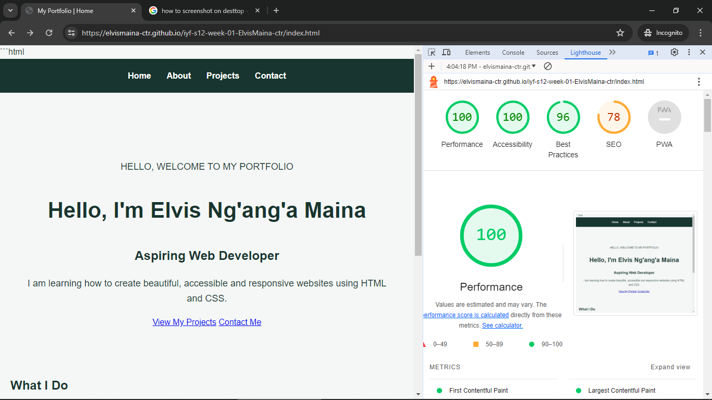

# Chrome dev and wave web

I used this tools as they are highly rated as the best in evaluation of website created.

For the wave web 
running my deployed , portfolio it 
gave a 10/10 score 

Inspecting it via chrome dev using lighthouse the accessibility performance audit was as displayed below
 
